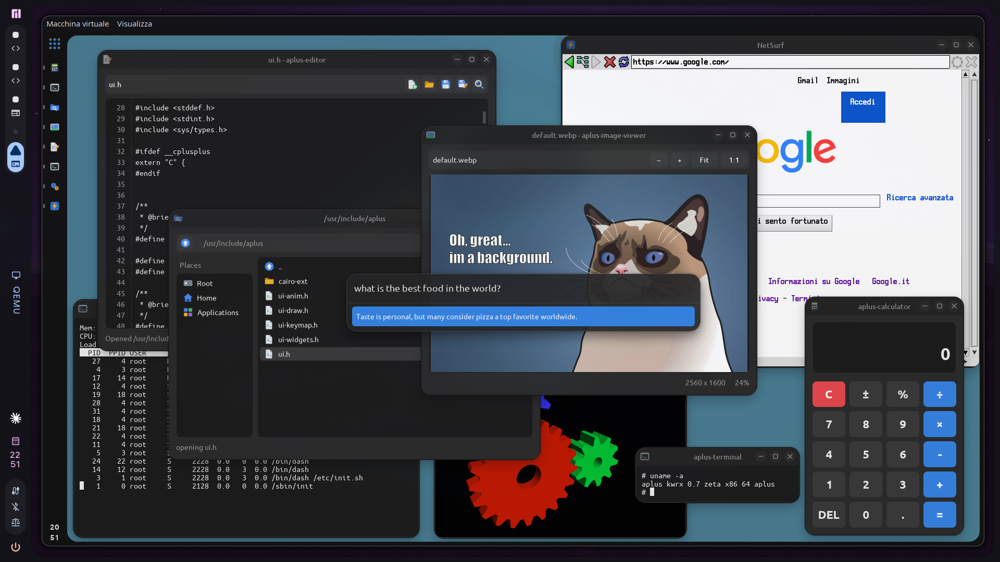
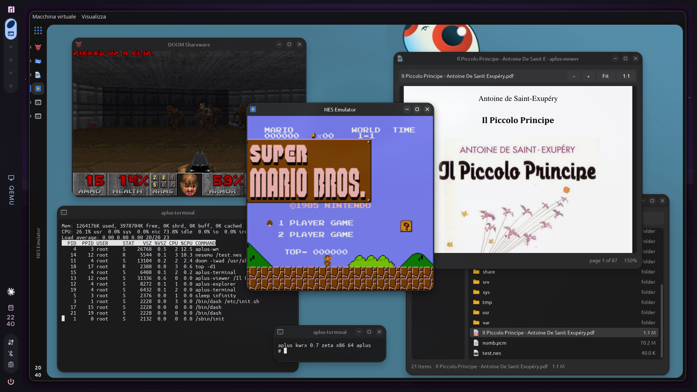
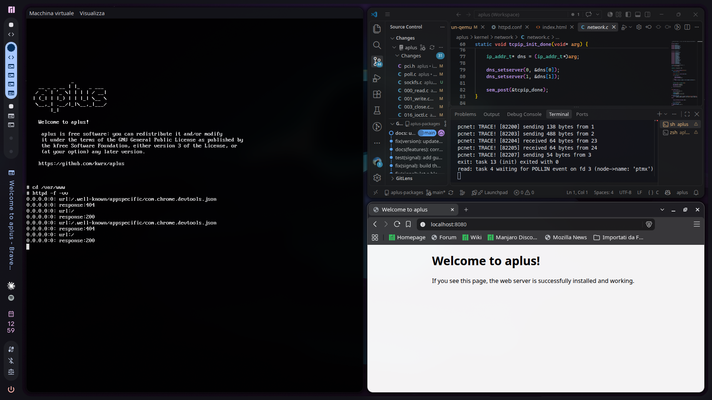

# aplus `#os`
[](https://github.com/kwrx/aplus/actions/workflows/release.yml)
[](https://github.com/kwrx/aplus/releases/latest)
[](/LICENSE) 

`aplus` is a Unix-like operating system built almost entirely from scratch — a hybrid kernel with loadable kernel modules, its own drivers, and a small userspace on top. The kernel is written in C, with assembly for the architecture-specific parts; the cross toolchain builds C and C++ programs to run on it.

It started in September 2013 as a way to learn low-level and systems programming, and it is still a hobby project rather than a production system. Today it boots on `x86_64` and provides a Linux-like syscall layer, a VFS with several filesystems, an lwIP TCP/IP stack, SMP multitasking and an early graphical stack — with a good deal still unimplemented.

## :fire: Features

* **Hybrid kernel**: modular design with loadable kernel objects, see [drivers/*](/drivers)
* **Cross-platform**: [arch/*](/arch), designed for cross-platform environment targets. `x86_64` is the target that boots and runs today; `i686` and `aarch64` are placeholders
* **Multitasking**: processes and threads (`fork`, `vfork`, `clone`, `execve`) with SMP support
* **Virtual memory**: on-demand paging with `mmap`, `mprotect` and `brk`
* **Filesystems**: [kernel/fs/](/kernel/fs), a VFS with ext2, ISO 9660, tmpfs, procfs and bindfs
* **Network**: [kernel/network/](/kernel/network), almost full TCP/IP Network Stack by [lwIP](https://savannah.nongnu.org/projects/lwip/), reachable through BSD sockets — ordinary file descriptors, so `dup2`, `fork` inheritance and `poll` work on them like any other, with `getsockname`, `getpeername` and `get`/`setsockopt` translating the Linux option numbers lwIP does not share
* **Unix-like**: Signals, Pipes, Futex, Unix domain sockets, TTY and PTY
* **I/O Multiplexing**: `poll`, `ppoll`, `select` and `pselect`
* **ELF**: static executables; dynamic linking is not supported yet
* **Linux Syscalls**: Linux-like syscall layer, see [SYSCALLS.md](/docs/SYSCALLS.md)
* **Linux Framebuffer**: Linux-like framebuffer support, with damage-based flushing and a hardware cursor plane on adapters that provide one
* **Virtio**: Virtio devices (gpu, net, input, console, random) over Virtio PCI
* **GUI**: a [display server](/apps/sysutils/aplus-wm) that owns the framebuffer and the input devices, draws window decorations itself, and hands out windows to clients over a Unix socket

See [FEATURES.md](/docs/FEATURES.md) for more information about features. 
  
<br>
<p align="center" width="100%">
    </img>
</p>

<p align="center" width="100%">
    </img>
</p>

More screenshots, from the v0.4 text console to the themed desktop, are in the [screenshot timeline](/docs/images/README.md).


## :electron: Kernel
The kernel provides a basic *unix* environment with a minimal subset of *posix* stuff.
It is a hybrid kernel: core subsystems are built in, while drivers are loadable kernel objects linked and started at runtime by the [module loader](/kernel/init/module.c).

* **Tasking**, per-CPU run queues with SMP support, signal delivery and futex-based sleeping
* **Memory**, [kernel/mm/](/kernel/mm), physical memory manager and kernel heap on top of on-demand paging
* **IPC**, [kernel/ipc/](/kernel/ipc), spinlocks, semaphores, futexes and Unix domain sockets
* **VFS**, [kernel/fs/](/kernel/fs), inode-based virtual filesystem with a dentry cache, and a `/proc` that exposes per-process state down to the open descriptors in `/proc/<pid>/fd`
* **Network**, [kernel/network/](/kernel/network), the lwIP stack wired up to the socket syscalls
* **Syscalls**, [kernel/syscalls/](/kernel/syscalls), one file per entry, numbered from [syscalls.json](/scripts/gen-syscalls/syscalls.json)

It currently boots and runs on `x86_64`; support for other architectures such as `i686` and `aarch64` is still to be written.


## :robot: Userspace
Userspace is still under development. It is built from this repository plus prebuilt packages that `./configure` fetches from [aplus-packages](https://github.com/kwrx/aplus-packages), and runs as a multi-user system on a unix-like filesystem with `/proc` and `/dev`.

* **Init**, [apps/core/init](/apps/core/init), runs the [init.sh](/apps/core/init/scripts/init.sh) boot script
* **Package manager**, [apps/core/pkg](/apps/core/pkg), `pkg` installs, upgrades and removes packages from the aplus-packages releases, tracking them in a local SQLite index
* **Desktop**, [aplus-wm](/apps/sysutils/aplus-wm), a display server that owns the framebuffer and the input devices and draws every window frame, with [libui](/lib/aplus/ui) for its clients
* **Applications**, [apps/sysutils](/apps/sysutils), terminal, file manager, text editor, PDF and image viewer, calculator, and a launcher with an optional AI assistant
* **Extras**, [apps/extra](/apps/extra), `kilo`, `nyancat`, an IRC client and MesaGL demos
* **Tests**, [apps/test](/apps/test), guest-side integration tests run from the shell
* **Packages**, BusyBox, `dash` and `bash`, the graphics and TLS libraries, MesaGL, [NetSurf](https://www.netsurf-browser.org/), [MuPDF](https://mupdf.com/), Doom, a NES emulator, the [Bochs](https://bochs.sourceforge.io/) PC emulator and a native `gcc` toolchain

Networking works end to end: below, BusyBox `httpd` serves a page from the guest to a browser on the host, through port `8080` forwarded by [run-qemu](/scripts/run-qemu).

<br>
<p align="center" width="100%">
    </img>
</p>


## :electric_plug: Drivers
Drivers are loadable kernel objects: one directory with a `main.c` per module, each declaring its identity and dependencies through `MODULE_NAME()`/`MODULE_DEPS()` and exporting `init`/`dnit` entry points. The tree currently builds 32 of them, covering device-class interfaces, char and block devices, terminals, input, network, video and virtio.

### Notable modules
* **Device Interface**, [dev/*](/drivers/dev), provides a standard interface for drivers (block, char, network, video, pci)
* **AHCI** (Advanced Host Controller Interface), [platform/pc/block/ahci](/drivers/platform/pc/block/ahci/main.c), almost full SATA/SATAPI driver
* **Bochs VGA**, [platform/pc/video/bochs-vga](/drivers/platform/pc/video/bochs-vga/main.c), Bochs Virtual VGA Adapter
* **VMware VGA**, [platform/pc/video/vmware](/drivers/platform/pc/video/vmware/main.c), VMware SVGA II Adapter
* **Intel e1000** (Network device), [platform/pc/network/e1000](/drivers/platform/pc/network/e1000/main.c), Intel NIC driver
* **PCNET** (Network device), [platform/pc/network/pcnet](/drivers/platform/pc/network/pcnet/main.c), AMD PCnet NIC driver
* **PS/2**, [platform/pc/input/ps2](/drivers/platform/pc/input/ps2/main.c), keyboard and mouse
* **TTY**, [tty/*](/drivers/tty), terminal devices, `/dev/ptmx` and pseudo-terminal pairs
* **VirtIO**, [virtio/*](/drivers/virtio), VirtIO device interfaces over VirtIO PCI — [gpu](/drivers/virtio/virtio-gpu/main.c) with damage flushing and a cursor plane, [input](/drivers/virtio/virtio-input/main.c) for absolute pointing devices, [net](/drivers/virtio/virtio-net/main.c) feeding the lwIP stack, plus console and random

---

## :zap: Getting Started

### Run a release:

Every push to `main` is built by the [release workflow](/.github/workflows/release.yml) and published as the `latest` development release.

1. Download the latest [release](https://github.com/kwrx/aplus/releases/latest): `release-aplus-<commit>-x86_64` holds the disk image and [run.sh](/ci/run.sh)
2. Requirements: `qemu-system-x86_64` and UEFI firmware (`ovmf` or `edk2-ovmf`)

```bash
tar xf release-aplus-*-x86_64.tar.xz
cd release-aplus-*-x86_64
./run.sh
```

First run prompts for:
- Architecture, disk image, UEFI firmware
- CPUs, RAM
- Virtio or emulated devices
- KVM support
- Display mode (local window or VNC)
- Opening the web dashboard (`http://localhost:8080`) in the browser at boot

Settings are saved to `config.txt`. Edit the file or run `./run.sh --reconfigure` to change settings; `./run.sh --defaults` skips the questions, `./run.sh --dry-run` prints the QEMU command line without running it. Use `./run.sh --help` for all available options.

The guest console is written to `console.log`, the QEMU monitor listens on `telnet 127.0.0.1:4444`, and the host port `8080` is forwarded to the guest's `8080`, where pymonitor serves its web dashboard.

### Build from Linux:
Clone this repository and change working directory.
```console
$ git clone https://github.com/kwrx/aplus
$ cd aplus
```

**NOTE:** It's recommended you use a **recent Linux** host environment with this method.

Some packages are **required** for the build system; `./configure` checks for all of them but `xz` and QEMU:
* `git`, `make`, `autoconf`, `automake` (or `build-essential` on Ubuntu/Debian)
* `gcc`, `ld` to compile sources and link objects
* `python3`, with `pip` and `venv`: `./configure` creates a `.venv` and installs [requirements.txt](/requirements.txt) into it
* `mke2fs`, `mkfs.vfat`, `mcopy`, `mmd`, `sgdisk`, `grub-mkstandalone`, `fakeroot`, `dd`, `truncate`, `fc-scan` to generate the hdd image — `grub-mkstandalone` also needs its `x86_64-efi` modules, packaged apart on some distributions (`grub-efi-amd64-bin` on Ubuntu/Debian)
* `tar`, `gzip`, `zip`, `find`, `awk`, `od` for the remaining build steps, and `xz` for the archives made by `./makew dist`
* `qemu-system-x86_64` with UEFI firmware (`ovmf` or `edk2-ovmf`) to run it

On **Ubuntu/Debian**, you can install all of them with:
```console
$ sudo apt install -y \
    git \
    build-essential \
    automake \
    autoconf \
    dosfstools \
    e2fsprogs \
    mtools \
    gdisk \
    fakeroot \
    grub-common \
    grub-efi-amd64-bin \
    fontconfig \
    gzip \
    tar \
    zip \
    xz-utils \
    python3 \
    python3-pip \
    python3-venv \
    qemu-system-x86 \
    ovmf
```

Then:

1. Configure and check environment
```console
$ ./configure
```
   This opens the Kconfig menu. To build a preset from [build/setup](/build/setup) without it:
```console
$ ./configure --kconfig x86_64
```

2. Build it
```console
$ ./makew all
```

3. Run it
```console
$ ./makew run
```
   Use `./makew run-headless` to run without a graphical display, which is handy to capture console output.

   Once booted, [pymonitor](/apps/extra/pymonitor) serves a web dashboard to monitor and control the guest at http://localhost:8080.

---

## :books: Documentation
* [FEATURES.md](/docs/FEATURES.md) — per-architecture and per-subsystem feature matrix
* [SYSCALLS.md](/docs/SYSCALLS.md) — the syscall table
* [REPORT.md](/docs/REPORT.md) — outstanding `TODO`/`FIXME` markers in the tree
* [docs/ui/](/docs/ui/README.md) — the display server, the wire protocol, and writing a graphical application against [libui](/lib/aplus/ui)

---

## :globe_with_meridians: Third-Party Software
`aplus` uses and depends on a large number of third-party open-source tools and libraries which are outside of this repository.

## :robot: AI Usage
The graphical userspace, namely the system applications under [apps/sysutils](/apps/sysutils) (display server, terminal, file explorer, ...) and the [libui](/lib/aplus/ui) library they are built on, has been written mostly with AI coding assistants. The rest of the project is mostly hand-written, with AI assistance used here and there.

## :page_with_curl: License
This project is licensed under the GNU General Public License v3.0 - see the [LICENSE](/LICENSE) file for details.

