# Screenshots

A timeline of aplus as it looked along the way, oldest first. Every screenshot was taken in a QEMU virtual machine, except for the last photo, taken on a real laptop; the newest screenshots were taken at 1920x1080 with `virtio-vga` and 4 CPUs.

 

## v0.4 — the text console

aplus was a 32-bit (`i386`) kernel with a text console. `init` mounted `/proc` and `/tmp`, started the system daemons and handed over to a login prompt.

    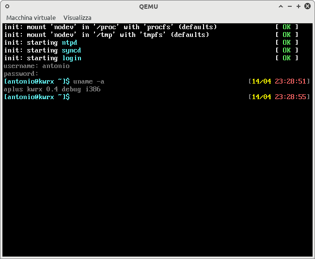</img>
    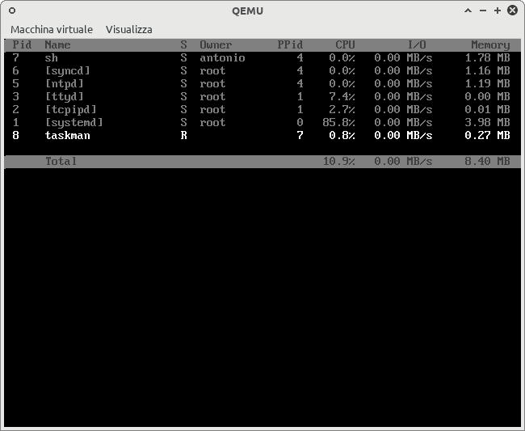</img>

* **Boot**: `init` mounts `procfs` and `tmpfs`, then starts `ntpd`, `syncd` and `login`
* **Shell**: a login session as a regular user, `uname` reporting `aplus kwrx 0.4 debug i386`
* **taskman**: a text-mode task manager with per-process CPU, I/O and memory usage

    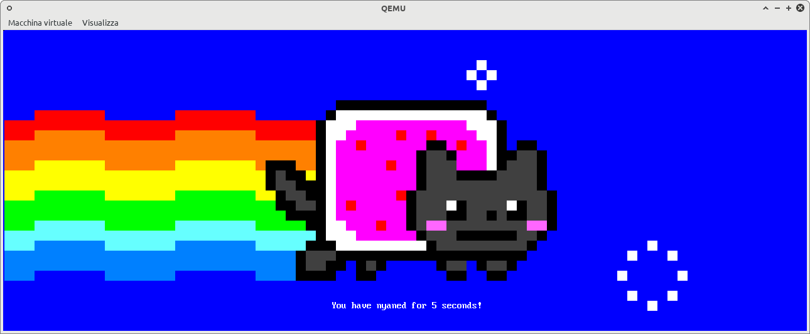</img>

`nyancat` running full screen.

    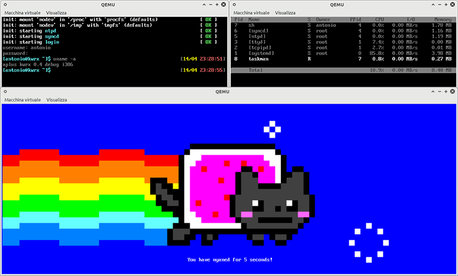</img>

All three side by side, each in its own virtual machine.

 

## v0.7 "zeta" — x86_64 and the framebuffer

### September 2026: framebuffer console and networking

aplus moved to `x86_64` with SMP, a Linux-like syscall layer and a linear framebuffer. Ported programs started to run unchanged: a text editor, MesaGL demos rendered with `softpipe`, and `nyancat`.

    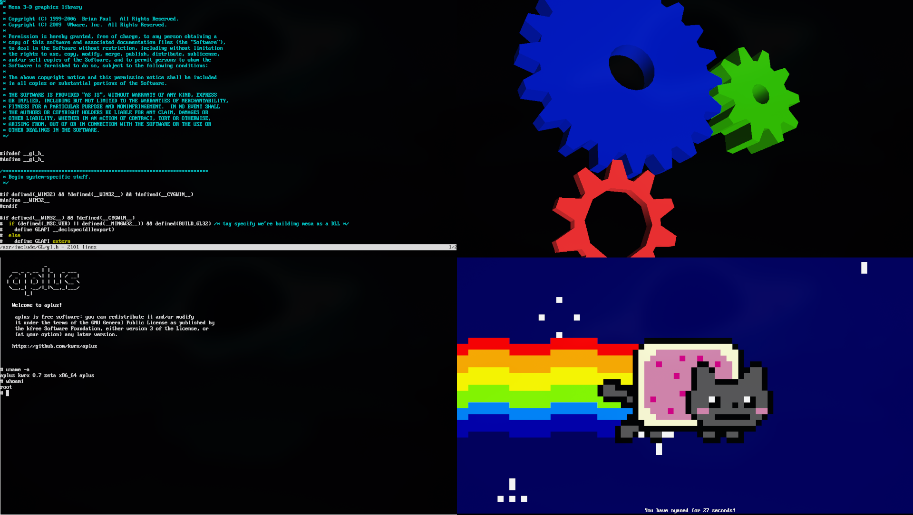</img>

With lwIP wired up to the socket syscalls and a virtio-net driver, BusyBox `httpd` serves a page from the guest to a browser on the host, through port `8080` forwarded by [run-qemu](/scripts/run-qemu).

    </img>

### September 2026: the first windows

[aplus-wm](/apps/sysutils/aplus-wm) took over the framebuffer and the input devices and started handing out windows over a Unix socket. `gl-gears` became the first OpenGL program to run in a window of its own.

    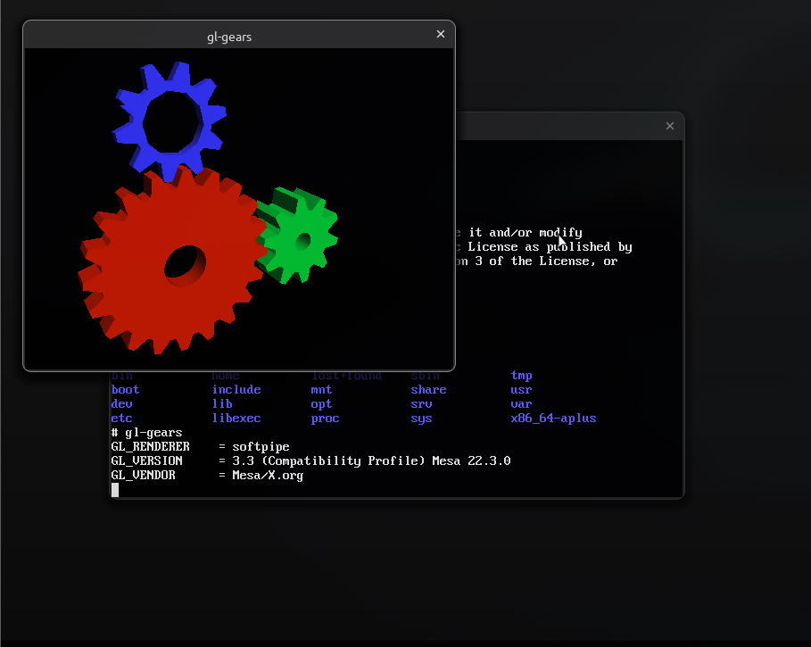</img>

### September – October 2026: the desktop

[libui](/lib/aplus/ui) grew a themed widget layer, and the desktop gained a taskbar, a launcher and the first applications: a terminal, a file explorer, a text editor, an image viewer and a calculator. The launcher can also ask an AI model, and NetSurf browses the web over HTTPS.

    </img>

Doom and a NES emulator joined as regular packages, along with a PDF viewer built on MuPDF; `top` reads every process from `/proc`.

    </img>

### Late October 2026: themes, settings and console mode

Themes are files read by the window manager and switched at runtime: `aplus-wmctl set-theme`, or the new [Settings](/apps/sysutils/aplus-settings) application, restyles every open window without restarting it, together with its fonts and wallpaper.

    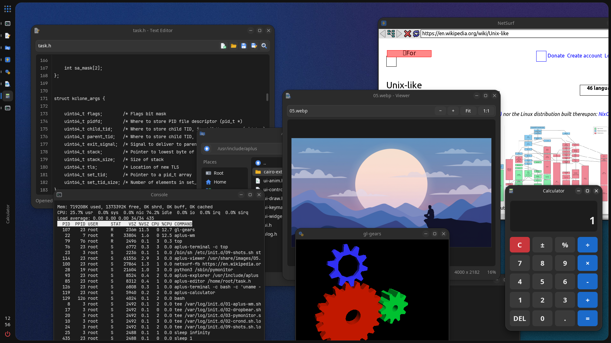</img>

    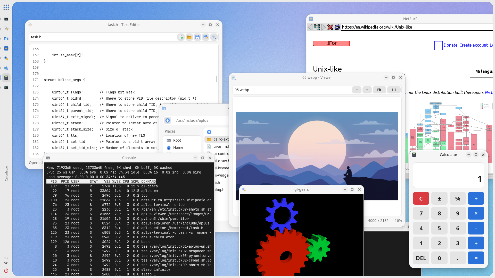</img>

* **Desktop**: the text editor on a kernel header, the explorer, `top`, NetSurf on Wikipedia over HTTPS, an image viewer, `gl-gears` and the calculator
* **Themes**: the dark and the light theme, each with its own generated wallpaper; the WM, libui and the applications all follow the switch

    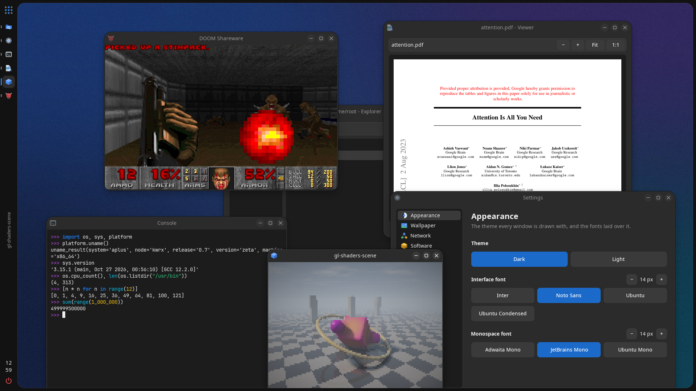</img>

* **Applications**: Doom, a paper downloaded over HTTPS and opened in the PDF viewer, an interactive Python 3.15 session, the MesaGL shaders demo and the Appearance page of Settings

    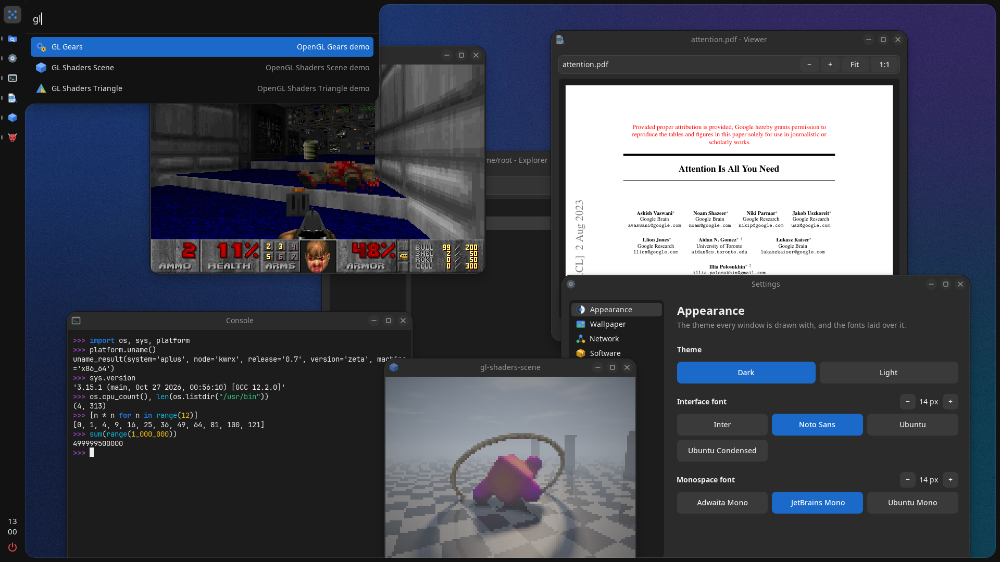</img>

* **Launcher**: slides out of the taskbar as a drawer and filters the installed applications as you type; a query starting with `>` runs a command

    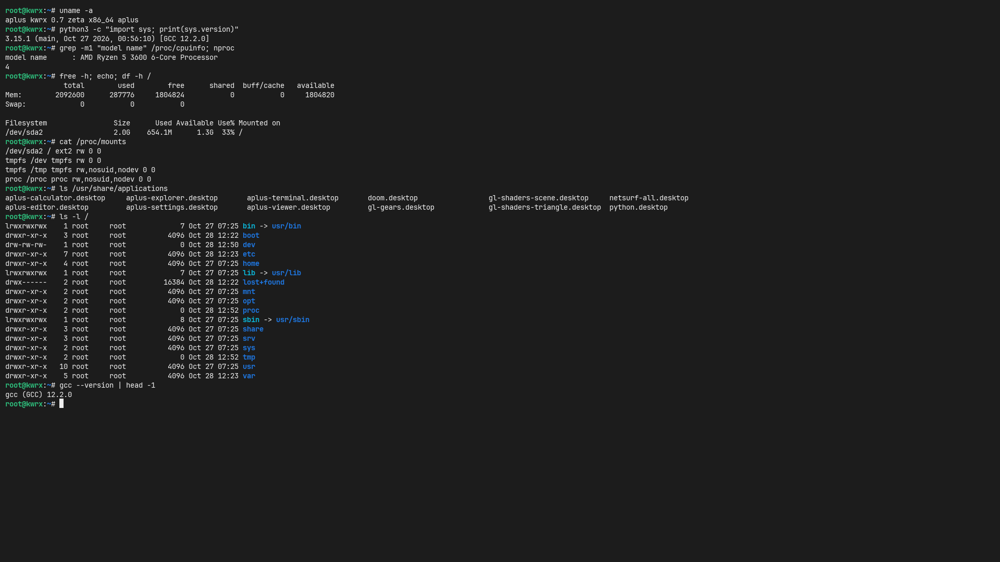</img>

* **Console mode**: the *aplus - Console Mode* boot entry skips the desktop and runs the terminal full screen on the framebuffer, with `bash`, Python and a native `gcc`

### Late October 2026: Linux inside aplus

[Bochs](https://bochs.sourceforge.io/) 3.1 was ported with a native frontend on libui and ships as a regular package. It emulates a 32-bit PC in an aplus window, fast enough to boot Tiny Core Linux to its desktop.

    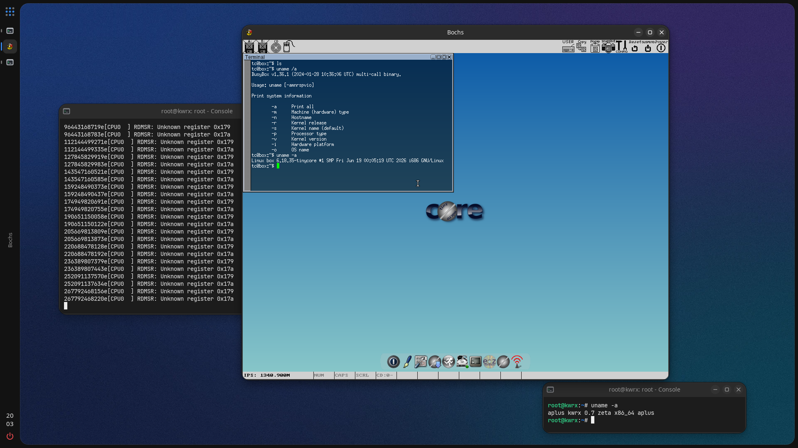</img>

* **Bochs**: Tiny Core Linux running in the emulator, where `uname -a` reports Linux on `i686`; the console below reports aplus on `x86_64`, and the one on the left shows the Bochs log

### Late October 2026: context menus and frosted glass

aplus-wm learned to draw context menus, both its own and on behalf of clients: an application asks for one with `UI_REQ_POPUP_MENU` and the window manager draws it in the window palette over a blurred backdrop, then drives it by mouse or keyboard. Translucent windows can ask for the same frosted backdrop with `UI_WINDOW_BLUR`. The three shots below also show two of the per-wallpaper themes generated by [gen-themes](/scripts/gen-themes), *crimson* and *dusk*.

    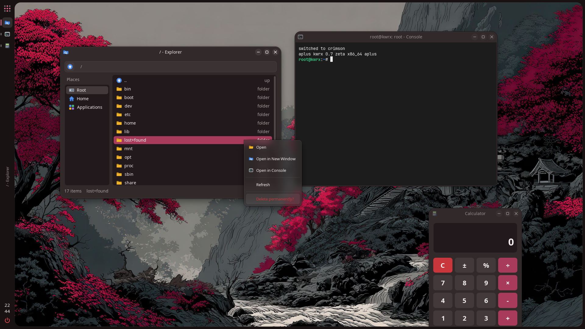</img>

* **Client menus**: a right press on a row in the explorer opens Open, Open in New Window, Open in Console, Refresh and Delete; Delete has to be pressed twice and turns into *Delete permanently?* in between. The wallpaper is frosted behind the menu

    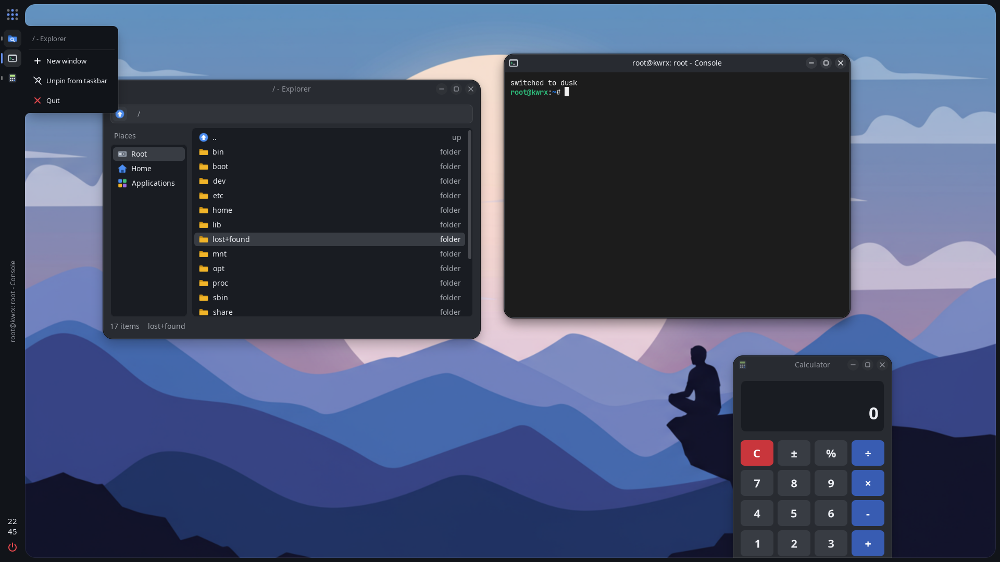</img>

* **Taskbar menu**: right-clicking a taskbar entry slides a menu out of the rail with New window, Pin to taskbar or Unpin from taskbar, and Quit. A pinned application keeps its entry after its windows close, and the pins persist in `/etc/ui/pinned.conf`

    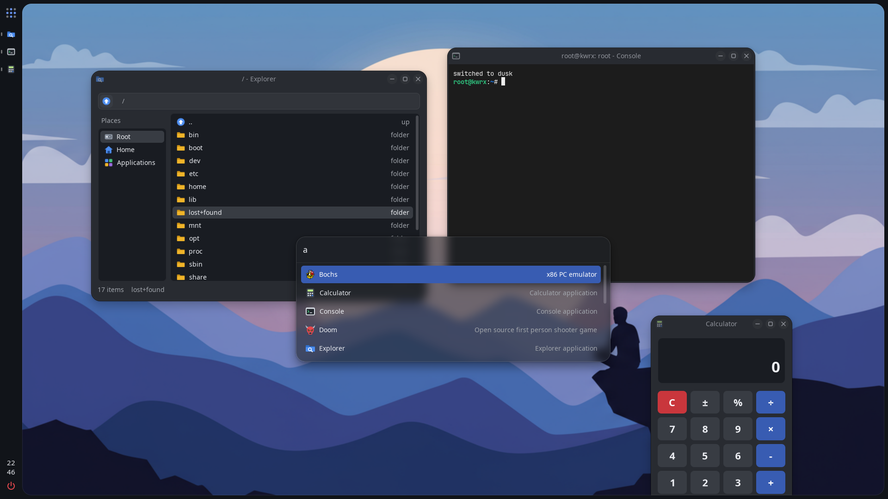</img>

* **Frosted launcher**: Super+Space opens the centred launcher as a `UI_WINDOW_BLUR` window, so the windows and the wallpaper behind it show through blurred

### Late October 2026: on real hardware

aplus running on a real machine, an old Huawei laptop with an 11th generation Intel Core i3. The desktop came up and the keyboard worked; the touchpad and the network card have no driver yet, so there is no mouse and no network.

    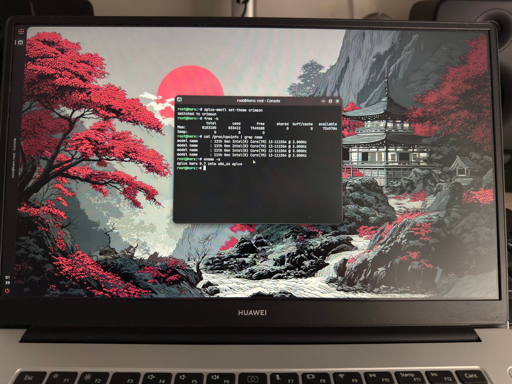</img>

* **Hardware**: `/proc/cpuinfo` lists the four threads of the Intel Core i3-1115G4 at 3.00 GHz, and `free -h` reports about 8 GB of memory with some 830 MB in use
